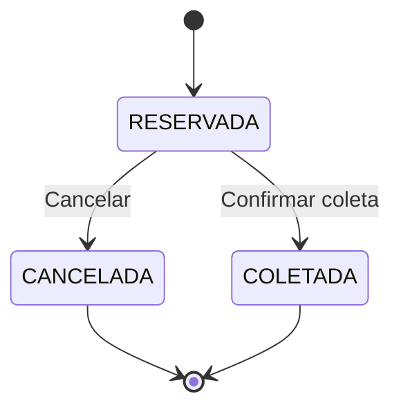
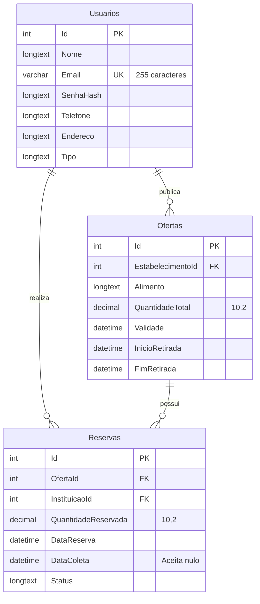
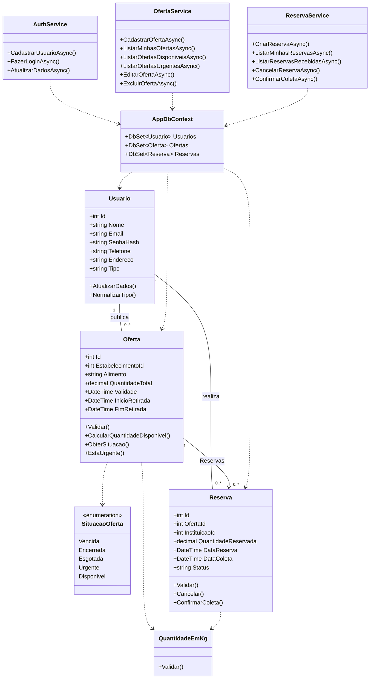
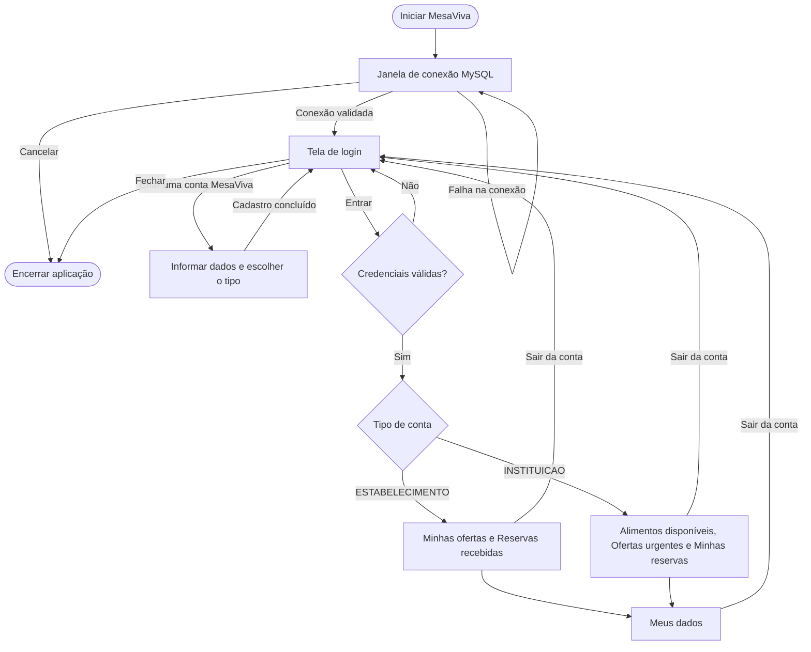

# MesaViva 🍞

**Trabalho integrador — Banco de Dados, Análise de Requisitos e Programação Orientada a Objetos (C#)**

**Integrantes:** Welinton e Leonardo  
**Tema:** Combate ao desperdício de alimentos

## 1. Sobre o projeto

O **MesaViva** é um aplicativo desktop para Windows, desenvolvido em C# com .NET 10 e Windows Forms, que conecta estabelecimentos com alimentos excedentes a instituições interessadas em recebê-los. Os dados são armazenados no MySQL por meio do Entity Framework Core (EF Core).

### Problema

Alimentos que poderiam ser aproveitados acabam desperdiçados, enquanto instituições precisam de doações para atender pessoas em situação de necessidade.

### Objetivo

Organizar a divulgação, a reserva e a retirada de alimentos excedentes, controlando as quantidades disponíveis e contribuindo para a redução do desperdício.

### Público-alvo

- **Estabelecimentos:** padarias, mercados, restaurantes e outros locais que possuem excedentes.
- **Instituições:** ONGs, abrigos e projetos sociais que recebem alimentos.

## 2. Funcionamento do sistema

O aplicativo verifica a conexão com o MySQL antes de abrir a tela de login. O usuário cria uma conta como estabelecimento ou instituição e entra com e-mail e senha. Após a autenticação, o sistema apresenta o painel correspondente ao tipo de conta.

- **Login** permite acessar uma conta ou abrir o formulário em **Criar uma conta MesaViva**.
- **Estabelecimento** cadastra e gerencia alimentos em **Minhas ofertas**, onde cada cartão exibe a situação, o saldo restante e a quantidade que pode ser reservada. Em **Reservas recebidas**, acompanha as solicitações e os status.
- **Instituição** identifica quem publicou cada oferta em **Alimentos disponíveis** e **Ofertas urgentes**. Em **Minhas reservas**, consulta o histórico, o horário da retirada e o nome, o endereço e o telefone cadastrados pelo estabelecimento. Também pode cancelar uma reserva ativa ou confirmar sua coleta.
- **Ambos os perfis** podem editar o cadastro em **Meus dados**, recarregar a página com **Atualizar** e retornar ao login com **Sair da conta**.

As ofertas são distribuídas em uma, duas ou três colunas conforme a largura disponível. O painel mantém limites de largura para os cartões, e os formulários oferecem rolagem quando o espaço é reduzido. Os tamanhos acompanham a escala de exibição do Windows.

### Exemplo prático

Uma padaria publica uma oferta de 12 kg de pães, com retirada das 16h às 18h. Uma instituição reserva 8 kg e outra reserva 4 kg. A oferta fica esgotada. Se a segunda instituição cancelar sua reserva, os 4 kg voltam a ficar disponíveis enquanto o alimento estiver válido e o prazo de retirada estiver aberto. Quando uma coleta é confirmada, sua quantidade continua comprometida. Às 18h, a oferta fica encerrada mesmo que ainda reste saldo.

## 3. Requisitos funcionais (RF)

| Código | Descrição | Situação no código |
|---|---|---|
| RF01 | Cadastrar usuários como estabelecimento ou instituição. | Implementado |
| RF02 | Realizar login por e-mail e senha. | Implementado |
| RF03 | Exibir um menu específico para cada tipo de conta. | Implementado |
| RF04 | Consultar e atualizar os próprios dados cadastrais. | Implementado |
| RF05 | Permitir que estabelecimentos cadastrem ofertas. | Implementado |
| RF06 | Permitir que estabelecimentos consultem suas ofertas. | Implementado |
| RF07 | Permitir a edição e exclusão das próprias ofertas, respeitando as regras de negócio. | Implementado |
| RF08 | Consultar as reservas recebidas nas próprias ofertas. | Implementado |
| RF09 | Consultar e buscar ofertas disponíveis. | A listagem identifica o estabelecimento. A busca por texto e os filtros personalizados ficaram fora da implementação. |
| RF10 | Permitir que instituições reservem quantidades de alimentos. | Implementado |
| RF11 | Consultar o histórico das próprias reservas e os dados do estabelecimento para a retirada. | Implementado |
| RF12 | Cancelar reservas ativas. | Implementado |
| RF13 | Confirmar a coleta de reservas ativas. | Implementado |
| RF14 | Consultar ofertas urgentes e identificar o estabelecimento responsável. | Implementado |

Os resultados da validação estão na seção 11.

## 4. Requisitos não funcionais (RNF)

| Código | Descrição |
|---|---|
| RNF01 | Utilizar C# com .NET 10. |
| RNF02 | Persistir dados no MySQL utilizando EF Core. |
| RNF03 | Oferecer uma interface desktop para Windows com menus interativos. |
| RNF04 | Aplicar conceitos de POO, como classes, métodos e encapsulamento de comportamentos. |
| RNF05 | Separar modelos, regras de negócio, acesso a dados e interface. |
| RNF06 | Validar entradas e apresentar mensagens de erro compreensíveis. |
| RNF07 | Armazenar senhas com hash seguro, nunca em texto puro no banco. |
| RNF08 | Gerenciar a estrutura do banco com Code First e Migrations. |
| RNF09 | Utilizar LINQ e async/await nas operações apropriadas de acesso a dados. |
| RNF10 | Configurar a conexão pela janela gráfica ou por variável de ambiente e manter as credenciais na máquina local. |
| RNF11 | Adaptar as telas à largura da janela e à escala de exibição do Windows. |

## 5. Regras de negócio (RN)

| Código | Regra |
|---|---|
| RN01 | Apenas usuários autenticados acessam os menus internos. |
| RN02 | Cada e-mail só pode estar associado a uma conta. |
| RN03 | Apenas estabelecimentos podem publicar e gerenciar ofertas. |
| RN04 | Apenas instituições podem realizar, cancelar e confirmar suas próprias reservas. |
| RN05 | Cada estabelecimento só pode alterar ou excluir suas próprias ofertas. |
| RN06 | A quantidade reservada deve ser positiva e não pode superar a disponibilidade. |
| RN07 | Não é permitido reservar alimentos vencidos ou após o encerramento da retirada. |
| RN08 | Cancelar uma reserva ativa libera sua quantidade. |
| RN09 | Somente reservas com status `RESERVADA` podem ser confirmadas ou canceladas. A confirmação pode ocorrer antes do início previsto para a retirada. |
| RN10 | Qualquer reserva registrada, inclusive cancelada ou coletada, bloqueia a exclusão da oferta e a alteração do nome do alimento. |
| RN11 | Uma oferta é urgente quando ainda pode receber reservas e faltam até duas horas para o fim da retirada. |
| RN12 | Todas as quantidades são expressas em quilogramas (kg). |
| RN13 | Quantidades devem ser positivas, ter até duas casas decimais e respeitar o limite de `DECIMAL(10,2)`. |
| RN14 | A edição de uma oferta não pode reduzir sua quantidade total abaixo da quantidade comprometida. |
| RN15 | O cadastro exige alimento válido e prazo de retirada ainda aberto. O início deve ser anterior ao fim, e os dois horários devem estar dentro da validade do alimento. |
| RN16 | Operações que afetam a mesma oferta utilizam transações e bloqueio de linha para evitar conflitos de disponibilidade. |
| RN17 | A instituição consulta o nome do estabelecimento na listagem de ofertas e também tem acesso ao endereço e ao telefone cadastrados nas próprias reservas. |
| RN18 | Novos nomes de alimentos e alterações de nome devem ser preenchidos sem números. |
| RN19 | Um número de telefone só pode ser cadastrado em uma conta. Edições que mantêm o próprio número são permitidas. |

### Saldo e situação das ofertas

```text
Saldo restante = Quantidade total - Quantidade comprometida
```

A quantidade comprometida é a soma das reservas `RESERVADA` e `COLETADA`. Ao cancelar uma reserva ativa, seu volume sai dessa soma. O saldo pode ser usado para novas reservas quando for positivo, a oferta estiver válida e o fim da retirada ainda estiver no futuro. A janela de retirada indica quando buscar os alimentos. É possível reservar antes do início previsto.

O MesaViva calcula a situação ao consultar as ofertas. Quando mais de uma condição se aplica, vale a primeira linha da tabela.

| Prioridade | Situação | Condição |
|---|---|---|
| 1 | Vencida | A validade do alimento foi ultrapassada. |
| 2 | Encerrada | O período de retirada terminou. |
| 3 | Esgotada | O saldo restante é zero ou negativo. |
| 4 | Urgente | Há saldo reservável e faltam até duas horas para o fim da retirada. |
| 5 | Disponível | Há saldo reservável e faltam mais de duas horas para o fim da retirada. |

**Alimentos disponíveis** reúne ofertas disponíveis e urgentes. **Ofertas urgentes** apresenta apenas as urgentes. Os cartões e os indicadores usam as mesmas regras. O MySQL armazena as datas, as quantidades e as reservas usadas no cálculo.

### Status das reservas



A confirmação registra a data e a hora em que a instituição realiza a ação. `CANCELADA` e `COLETADA` são estados finais e permanecem no histórico.

## 6. Diagramas

Os diagramas utilizam Mermaid, com renderização no GitHub. São representações simplificadas da implementação atual.

### 6.1. Diagrama de casos de uso


### 6.2. Diagrama entidade-relacionamento (DER)

O modelo utiliza as tabelas `Usuarios`, `Ofertas` e `Reservas`. Os nomes abaixo seguem o mapeamento da migration `InitialCreate`.



Cada oferta pertence a um estabelecimento. Cada reserva pertence a uma instituição e a uma oferta. Os dois perfis são representados pela tabela `Usuarios` e diferenciados pelo campo `Tipo`. O índice único de `Email` evita cadastros duplicados, e as chaves estrangeiras utilizam exclusão restrita. Para exibir os dados de retirada, as consultas associam ofertas e reservas ao cadastro do estabelecimento.

### 6.3. Diagrama de classes

O sistema representa ambos os perfis com a classe `Usuario`. O diagrama mostra os atributos principais e usa assinaturas simplificadas.



Em `Reserva`, a propriedade `DataColeta` é do tipo `DateTime?` (pode ser nula).

Os serviços retornam resultados de consulta para a interface. `OfertaComDisponibilidade` reúne a oferta, sua situação, o saldo, a quantidade reservável e o nome do estabelecimento quando a consulta é feita por uma instituição. `ReservaDetalhada` reúne a reserva e seus detalhes. A consulta de **Minhas reservas** inclui o endereço e o telefone do estabelecimento.

### 6.4. Fluxo de acesso e navegação



## 7. Estrutura do código

```text
Projeto-Integrador-Trabalho/
├── Data/
│   ├── AppDbContext.cs
│   └── ConexaoMySql.cs
├── Migrations/
│   ├── 20261118163254_InitialCreate.cs
│   ├── 20261118163254_InitialCreate.Designer.cs
│   └── AppDbContextModelSnapshot.cs
├── models/
│   ├── Usuario.cs
│   ├── Oferta.cs
│   ├── Reserva.cs
│   └── QuantidadeEmKg.cs
├── Services/
│   ├── AuthService.cs
│   ├── OfertaService.cs
│   └── ReservaService.cs
├── UI/
│   ├── ConexaoForm.cs
│   ├── LoginForm.cs
│   ├── PainelForm.cs
│   ├── Dialogos.cs
│   └── EstiloMesaViva.cs
├── Utils.cs
├── Program.cs
├── Projeto-Integrador-Trabalho.csproj
├── .gitignore
├── LICENSE
└── README.md
```

| Componente | Responsabilidade |
|---|---|
| `models/` | Entidades, validações e comportamentos de domínio. |
| `Services/` | Autenticação, permissões, consultas e operações que persistem dados. |
| `Data/` | Configuração e verificação da conexão, mapeamento do EF Core e bloqueio de linha. |
| `Migrations/` | Histórico de evolução da estrutura do banco. |
| `UI/` | Janela de conexão, login, cadastro, painéis por perfil, formulários e estilos compartilhados. |
| `Utils.cs` | Formatação de datas e quantidades para exibição. |
| `Program.cs` | Inicialização do Windows Forms, abertura da conexão e da tela de login. |

## 8. Banco de dados e execução

O projeto aplica os conceitos da Aula 11.5 — Entity Framework Core, do professor Bruno Martins: entidades C#, DbContext, DbSets, Code First, Migrations, LINQ e operações assíncronas.

### 8.1. Pré-requisitos

- Windows e SDK do .NET 10.
- Servidor MySQL em execução e acessível.
- Uma conta MySQL autorizada a acessar o banco do MesaViva. A preparação inicial do esquema precisa de permissão para aplicar migrations.
- Ferramenta `dotnet-ef` para as operações de migrations.
- Git, caso seja necessário clonar o repositório.

### 8.2. Clonar e restaurar o projeto

Abra o PowerShell na pasta do projeto recebido. Para baixar a branch de desenvolvimento publicada, use estes comandos no diretório onde deseja criar a pasta do projeto.

```powershell
git clone --branch feature/models-welinton https://github.com/leonardocamilofrank-hue/Projeto-Integrador-Trabalho.git
cd Projeto-Integrador-Trabalho
```

Com o terminal na pasta do projeto, restaure as dependências.

```powershell
dotnet restore .\Projeto-Integrador-Trabalho.csproj
```

### 8.3. Preparar o banco e configurar `MESAVIVA_DB`

No MySQL, prepare um banco para o MesaViva, por exemplo `mesaviva`, e use uma conta com permissão nesse banco. Aponte `MESAVIVA_DB` para esse banco na sessão do PowerShell em que vai executar os comandos do EF Core. Substitua os valores de demonstração pelos dados da sua instalação local.

```powershell
$env:MESAVIVA_DB = "Server=localhost;Port=3306;Database=mesaviva;User=SEU_USUARIO;Password=SUA_SENHA;"
```

A variável vale para o terminal atual e os processos iniciados nele. O `AppDbContext` lê o valor pela configuração de conexão. Mantenha os dados reais da conta na instalação local.

### 8.4. Aplicar as migrations

Verifique se o `dotnet-ef` está instalado.

```powershell
dotnet ef --version
```

Se o comando estiver indisponível, instale uma versão alinhada às dependências do EF Core do projeto.

```powershell
dotnet tool install --global dotnet-ef --version 10.0.12
```

Com `MESAVIVA_DB` configurada, aplique a migration `InitialCreate` ao banco que preparou.

```powershell
dotnet ef database update --project .\Projeto-Integrador-Trabalho.csproj
```

A janela de conexão verifica o esquema na abertura. A aplicação de migrations é feita manualmente pelo comando acima. Para comparar o modelo ao snapshot do repositório, execute `dotnet ef migrations has-pending-model-changes`.

### 8.5. Compilar e executar

```powershell
dotnet build .\Projeto-Integrador-Trabalho.csproj
dotnet run --project .\Projeto-Integrador-Trabalho.csproj
```

O `dotnet run` abre a janela **Conexão com MySQL**. Se a variável `MESAVIVA_DB` estiver definida, o programa verifica a conexão indicada. Caso contrário, informe somente a senha para usar os valores padrão (`localhost`, porta `3306`, banco `mesaviva`, usuário `root`). Se sua instalação usa outros valores, marque **Configurações avançadas** e informe servidor, porta, banco e usuário. O login abre após a validação. Se houver falha, a janela exibe a mensagem e permite corrigir os dados e tentar novamente.

As quantidades são exibidas em quilogramas. Nos formulários, o campo numérico usa o separador decimal do Windows. Digite a validade e os dois horários de retirada nos campos com máscara `dd/MM/aaaa HH:mm`. No cadastro, as máscaras exibem os separadores e aguardam a digitação. O telefone exige 11 dígitos com DDD e usa o formato `(00) 00000-0000`.

### 8.6. Persistência e segurança

- `AppDbContext` mapeia as três entidades para o MySQL, com índice único para e-mail e relacionamentos por chaves estrangeiras.
- O CRUD utiliza EF Core, com métodos assíncronos como `ToListAsync` e `SaveChangesAsync`.
- As consultas LINQ obtêm os dados de retirada junto às ofertas e reservas. Cada listagem solicita ao banco os dados necessários ao conjunto de cartões exibidos.
- O hash das senhas usa PBKDF2-SHA256, com salt aleatório e 600 mil iterações.
- Novas contas utilizam os tipos `ESTABELECIMENTO` e `INSTITUICAO`. O login também reconhece as representações antigas por meio de normalização.
- Operações de reserva, cancelamento, coleta, edição e exclusão de ofertas utilizam transações. O `SELECT ... FOR UPDATE` bloqueia a linha da oferta para coordenar alterações concorrentes, e o EF Core executa as leituras e gravações do fluxo.

O exemplo simplificado mostra como uma consulta LINQ seleciona ofertas do estabelecimento autenticado.

```csharp
var minhasOfertas = await context.Ofertas
    .Where(oferta => oferta.EstabelecimentoId == usuarioLogado.Id)
    .ToListAsync();
```

O EF Core mapeia classes C# para as tabelas e traduz consultas LINQ em operações que o MySQL executa.

## 9. Tecnologias utilizadas

| Tecnologia | Utilização |
|---|---|
| C# / .NET 10 | Aplicativo desktop e programação orientada a objetos. |
| Windows Forms | Janelas, navegação e formulários. |
| MySQL | Banco de dados relacional. |
| Entity Framework Core | Mapeamento e persistência de dados. |
| `Microsoft.EntityFrameworkCore.Design` 10.0.12 | Ferramentas de design e migrations. |
| `MySql.EntityFrameworkCore` 10.0.12 | Provedor MySQL para EF Core. |
| LINQ e async/await | Consultas e operações assíncronas. |
| Git e GitHub | Versionamento e colaboração. |
| Mermaid | Diagramas da documentação. |

As versões acima correspondem ao arquivo `.csproj` da implementação documentada. `dotnet list package` permite conferir as dependências instaladas.

## 10. Demonstração na apresentação

1. Conectar ao banco de demonstração e cadastrar uma conta de estabelecimento e outra de instituição.
2. Entrar como estabelecimento. Publicar uma oferta com retirada terminando em até duas horas e outra com prazo maior. Para demonstrar a confirmação antecipada, agendar o início da retirada da primeira oferta para depois do momento da apresentação. Manter o fim de cada retirada dentro da validade do alimento.
3. Entrar como instituição. Consultar **Alimentos disponíveis** e **Ofertas urgentes** para comparar as situações e identificar os estabelecimentos.
4. Reservar uma quantidade válida, conferir o endereço e o telefone em **Minhas reservas** e tentar reservar acima do saldo disponível.
5. Cancelar a reserva e verificar a devolução ao saldo. Fazer outra reserva e confirmar a coleta antes do horário previsto para demonstrar que a ação é permitida e registra o horário real.
6. Retornar ao painel do estabelecimento, conferir o histórico em **Reservas recebidas** e demonstrar os bloqueios de alteração do alimento e exclusão. Mostrar uma edição permitida, como aumentar a quantidade total.
7. Atualizar os dados em **Meus dados**, fechar o aplicativo e reabri-lo para mostrar a persistência.
8. Apresentar os diagramas e explicar a consulta ao cadastro do estabelecimento, o cálculo de disponibilidade e o bloqueio contra reservas concorrentes.

## 11. Validação e limitações

Em 27/11/2026, a validação utilizou dados de demonstração em uma instância MySQL 8.4 isolada. Foram aprovados 30 casos de integração, 13 casos com as janelas reais do Windows Forms e uma verificação adicional de persistência em um novo processo.

| Verificação | Resultado |
|---|---|
| `dotnet build` | Compilação concluída com 0 avisos e 0 erros. |
| `dotnet ef migrations has-pending-model-changes` | Modelo compatível com a última migration. |
| Contas e conexão | Cadastro e login dos dois perfis, normalização de conta antiga, edição cadastral, conexão avançada, `MESAVIVA_DB` e falhas de conexão. |
| Ofertas e reservas | Publicação, validações de datas e quantidades, cinco situações, saldo e quantidade reservável, histórico, cancelamento, coleta antecipada, concorrência e contatos de retirada. |
| Interface e persistência | Grades de uma a três colunas, nomes e endereços extensos, rolagem, ações acessíveis e recuperação do histórico e do cadastro após reabrir. Janela maximizada em 1920 × 1080 e testes com redimensionamento a 96 DPI. |

A tela de conexão simplificada teve os campos e valores padrão conferidos. A autenticação com MySQL ocorreu no banco isolado, pela configuração avançada e por `MESAVIVA_DB`. A porta padrão da instalação real ficou fora da execução de testes.

A revisão dos formulários teve quatro casos adicionais aprovados no MySQL isolado e dois no Windows Forms. Foram verificados o bloqueio de novos nomes com números, telefones repetidos com formatos diferentes, cadastros simultâneos, campos de data vazios, datas inválidas e a preservação das datas já salvas.

A busca por texto e os filtros personalizados ficaram fora da implementação. O cartão de reserva mostra os dados cadastrais atuais do estabelecimento. A atualização desses dados vale para as próximas consultas, inclusive as do histórico.

## 12. Status do projeto

- [x] Definição do tema e escopo.
- [x] Planejamento dos requisitos.
- [x] Modelagem das entidades e configuração do EF Core.
- [x] Criação da migration inicial.
- [x] Cadastro, autenticação e menus por perfil.
- [x] Gerenciamento de ofertas, reservas e dados cadastrais.
- [x] Situações das ofertas e identificação do estabelecimento nas consultas da instituição.
- [x] Atualização da documentação e dos diagramas para refletir o código.
- [ ] Revisão final da dupla e integração à branch principal.
- [ ] Preparação e realização da apresentação final.

Esta documentação descreve a etapa final local da branch `feature/models-welinton`.

## Licença

O projeto utiliza a licença MIT. Consulte o arquivo [LICENSE](LICENSE).

---

**MesaViva — projeto acadêmico desenvolvido por Welinton e Leonardo.**

*Referência de estudo: Aula 11.5 — Entity Framework Core, Programação Orientada a Objetos, professor Bruno Martins.*
