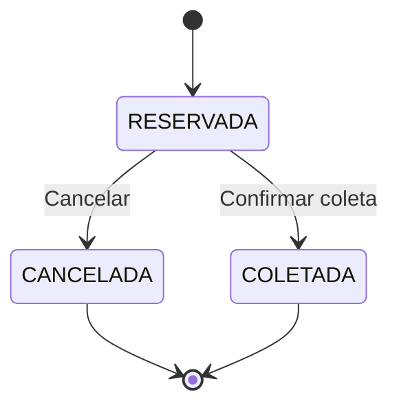
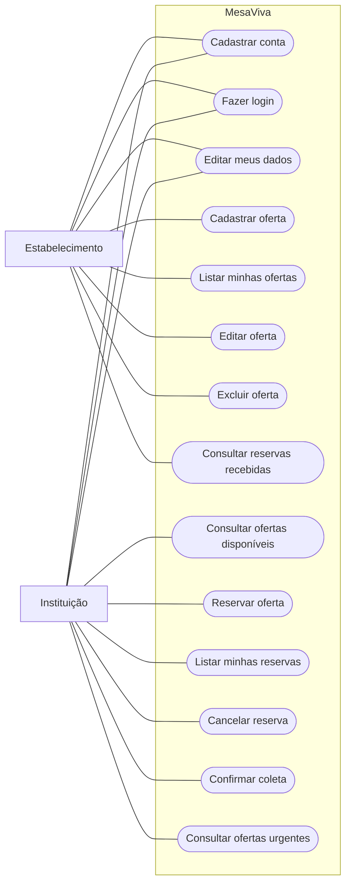
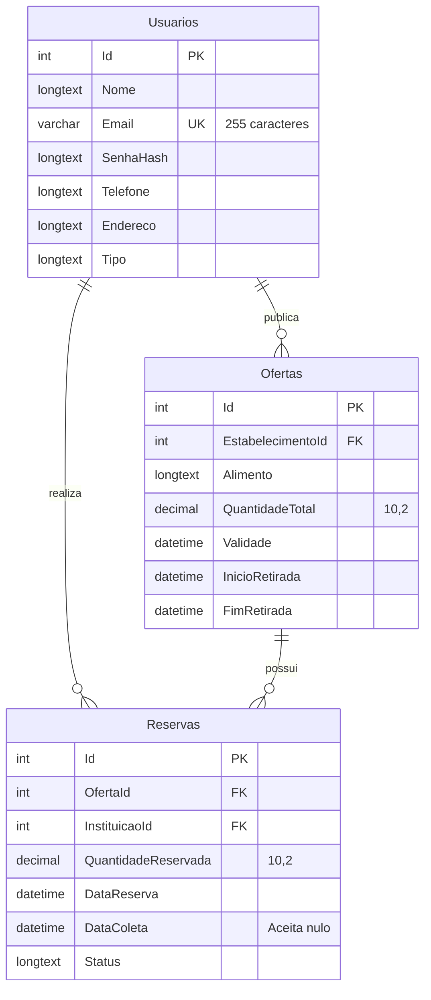
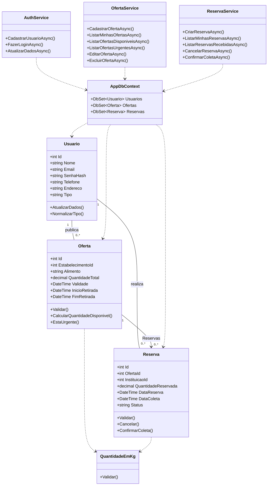
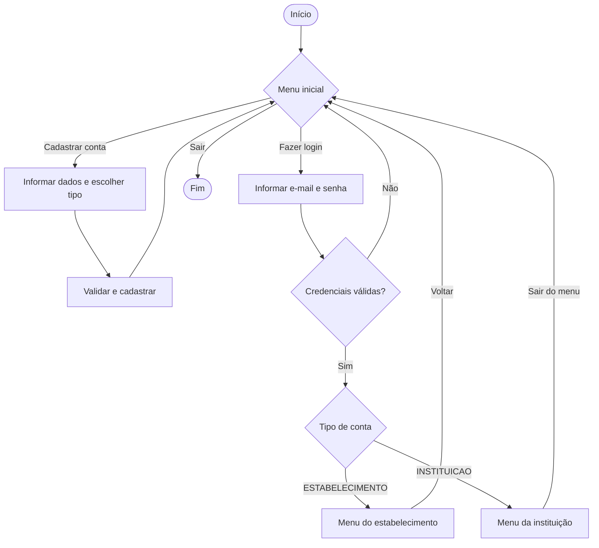

# MesaViva 🍞

**Trabalho integrador — Banco de Dados, Análise de Requisitos e Programação Orientada a Objetos (C#)**

**Integrantes:** Welinton e Leonardo  
**Tema:** Combate ao desperdício de alimentos

## 1. Sobre o projeto

O **MesaViva** é um sistema de console desenvolvido em C# com .NET 10, que conecta estabelecimentos com alimentos excedentes a instituições interessadas em recebê-los. Os dados são armazenados no MySQL por meio do Entity Framework Core (EF Core).

### Problema

Alimentos que poderiam ser aproveitados acabam desperdiçados, enquanto instituições precisam de doações para atender pessoas em situação de necessidade.

### Objetivo

Organizar a divulgação, a reserva e a retirada de alimentos excedentes, controlando as quantidades disponíveis e contribuindo para a redução do desperdício.

### Público-alvo

- **Estabelecimentos:** padarias, mercados, restaurantes e outros locais que possuem excedentes.
- **Instituições:** ONGs, abrigos e projetos sociais que recebem alimentos.

## 2. Funcionamento do sistema

O usuário cria uma conta como estabelecimento ou instituição e realiza o login com e-mail e senha. Após a autenticação, o sistema apresenta o menu correspondente ao tipo de conta. Não existe perfil de administrador.

### Menu inicial

```text
========== MESAVIVA ==========
1 - Fazer login
2 - Cadastrar conta
0 - Sair
```

### Menu do estabelecimento

```text
1 - Cadastrar oferta
2 - Listar minhas ofertas
3 - Editar oferta
4 - Excluir oferta
5 - Consultar reservas das minhas ofertas
6 - Editar meus dados
0 - Voltar
```

### Menu da instituição

```text
1 - Consultar ofertas disponíveis
2 - Reservar oferta
3 - Listar minhas reservas
4 - Cancelar reserva
5 - Confirmar coleta
6 - Consultar ofertas urgentes
7 - Editar meus dados
0 - Sair do menu
```

A opção `0` nos menus internos encerra a sessão e retorna ao menu inicial. Na edição cadastral, pressionar Enter em um campo mantém o valor atual.

### Exemplo prático

Uma padaria publica uma oferta de 12 kg de pães, com retirada das 16h às 18h. Uma instituição reserva 8 kg e outra reserva 4 kg. Como toda a quantidade foi comprometida, novas reservas são bloqueadas. Se uma reserva ativa for cancelada, sua quantidade volta a ficar disponível. Após a retirada, cada instituição confirma sua coleta.

## 3. Requisitos funcionais (RF)

| Código | Descrição | Situação no código |
|---|---|---|
| RF01 | Cadastrar usuários como estabelecimento ou instituição. | Implementado |
| RF02 | Realizar login por e-mail e senha. | Implementado |
| RF03 | Exibir um menu específico para cada tipo de conta. | Implementado |
| RF04 | Consultar e atualizar os próprios dados cadastrais. | Implementado |
| RF05 | Permitir que estabelecimentos cadastrem ofertas. | Implementado |
| RF06 | Permitir que estabelecimentos consultem suas ofertas. | Implementado |
| RF07 | Permitir a edição e exclusão das próprias ofertas, respeitando as regras de negócio. | Implementado |
| RF08 | Consultar as reservas recebidas nas próprias ofertas. | Implementado |
| RF09 | Consultar e buscar ofertas disponíveis. | Parcial: listagem implementada; busca por termo ou filtros personalizados não implementada |
| RF10 | Permitir que instituições reservem quantidades de alimentos. | Implementado |
| RF11 | Consultar as próprias reservas. | Implementado |
| RF12 | Cancelar reservas ativas. | Implementado |
| RF13 | Confirmar a coleta de reservas ativas. | Implementado |
| RF14 | Consultar ofertas urgentes. | Implementado |

A situação indica a presença da implementação no código-fonte, não a aprovação em todos os testes de integração.

## 4. Requisitos não funcionais (RNF)

| Código | Descrição |
|---|---|
| RNF01 | Utilizar C# com .NET 10. |
| RNF02 | Persistir dados no MySQL utilizando EF Core. |
| RNF03 | Oferecer uma interface de console com menus interativos. |
| RNF04 | Aplicar conceitos de POO, como classes, métodos e encapsulamento de comportamentos. |
| RNF05 | Separar modelos, regras de negócio, acesso a dados e interface. |
| RNF06 | Validar entradas e apresentar mensagens de erro compreensíveis. |
| RNF07 | Armazenar senhas com hash seguro, nunca em texto puro no banco. |
| RNF08 | Gerenciar a estrutura do banco com Code First e Migrations. |
| RNF09 | Utilizar LINQ e async/await nas operações apropriadas de acesso a dados. |
| RNF10 | Configurar a conexão por variável de ambiente, sem publicar credenciais. |

## 5. Regras de negócio (RN)

| Código | Regra |
|---|---|
| RN01 | Apenas usuários autenticados acessam os menus internos. |
| RN02 | Cada e-mail só pode estar associado a uma conta. |
| RN03 | Apenas estabelecimentos podem publicar e gerenciar ofertas. |
| RN04 | Apenas instituições podem realizar, cancelar e confirmar suas próprias reservas. |
| RN05 | Cada estabelecimento só pode alterar ou excluir suas próprias ofertas. |
| RN06 | A quantidade reservada deve ser positiva e não pode superar a disponibilidade. |
| RN07 | Não é permitido reservar alimentos vencidos ou após o encerramento da retirada. |
| RN08 | Cancelar uma reserva ativa libera sua quantidade. |
| RN09 | Somente reservas com status `RESERVADA` podem ser confirmadas ou canceladas. |
| RN10 | Ofertas com qualquer reserva registrada, inclusive cancelada, não podem ser excluídas. |
| RN11 | Uma oferta é urgente quando faltam até duas horas para o fim da retirada, o alimento não está vencido e há disponibilidade. |
| RN12 | Todas as quantidades são expressas em quilogramas (kg). |
| RN13 | Quantidades devem ser positivas, ter até duas casas decimais e respeitar o limite de `DECIMAL(10,2)`. |
| RN14 | A edição de uma oferta não pode reduzir sua quantidade total abaixo da quantidade comprometida. |
| RN15 | O cadastro de ofertas exige alimento não vencido e período de retirada ainda aberto. O início da retirada deve ser anterior ao fim e a validade não pode ser anterior ao início. |
| RN16 | Operações que afetam a mesma oferta utilizam transações e bloqueio de linha para evitar conflitos de disponibilidade. |

As regras RN13 a RN16 detalham validações presentes na implementação atual.

### Cálculo da disponibilidade

```text
Quantidade disponível = Quantidade total - Quantidade comprometida
```

A quantidade comprometida é a soma das reservas com status `RESERVADA` ou `COLETADA`. Reservas `CANCELADA` não ocupam quantidade. A disponibilidade é calculada, não armazenada em uma coluna redundante.

### Status das reservas



A confirmação registra a data da coleta. Uma reserva cancelada ou coletada não pode voltar ao estado ativo.

## 6. Diagramas

Os diagramas utilizam Mermaid, com renderização no GitHub. São representações simplificadas da implementação atual.

### 6.1. Diagrama de casos de uso



### 6.2. Diagrama entidade-relacionamento (DER)

O modelo utiliza três tabelas: `Usuarios`, `Ofertas` e `Reservas`. Os nomes abaixo seguem o mapeamento da migration `InitialCreate`.



Cada oferta pertence a um estabelecimento; cada reserva pertence a uma instituição e a uma oferta. Os dois perfis são representados pela mesma tabela `Usuarios`, diferenciados pelo campo `Tipo`. O índice único de `Email` evita cadastros duplicados, e as chaves estrangeiras utilizam exclusão restrita.

### 6.3. Diagrama de classes

O sistema utiliza uma única classe `Usuario`, sem herança para os perfis. O diagrama mostra os atributos e métodos principais; as assinaturas foram simplificadas para facilitar a leitura.



Em `Reserva`, a propriedade `DataColeta` é do tipo `DateTime?` (pode ser nula).

### 6.4. Fluxo de login e menus



## 7. Estrutura do código

```text
Projeto-Integrador-Trabalho/
├── Data/
│   └── AppDbContext.cs
├── Migrations/
│   ├── 20261118163254_InitialCreate.cs
│   ├── 20261118163254_InitialCreate.Designer.cs
│   └── AppDbContextModelSnapshot.cs
├── models/
│   ├── Usuario.cs
│   ├── Oferta.cs
│   ├── Reserva.cs
│   └── QuantidadeEmKg.cs
├── Services/
│   ├── AuthService.cs
│   ├── OfertaService.cs
│   └── ReservaService.cs
├── UI/
│   ├── MenuInicial.cs
│   ├── MenuEstabelecimento.cs
│   ├── MenuInstituicao.cs
│   └── MenuComum.cs
├── Utils.cs
├── Program.cs
├── Projeto-Integrador-Trabalho.csproj
├── .gitignore
├── LICENSE
└── README.md
```

| Componente | Responsabilidade |
|---|---|
| `models/` | Entidades, validações e comportamentos de domínio. |
| `Services/` | Regras de negócio, permissões, consultas e persistência. |
| `Data/` | Configuração do EF Core, relacionamentos e acesso ao banco. |
| `Migrations/` | Histórico de evolução da estrutura do banco. |
| `UI/` | Menus, apresentação de dados e interação com o usuário. |
| `Utils.cs` | Entrada de textos, inteiros, decimais, datas e formatação de quantidades. |
| `Program.cs` | Inicialização da aplicação e composição dos Services. |

## 8. Banco de dados e execução

O projeto aplica os conceitos da Aula 11.5 — Entity Framework Core, do professor Bruno Martins: entidades C#, DbContext, DbSets, Code First, Migrations, LINQ e operações assíncronas.

### 8.1. Pré-requisitos

- SDK do .NET 10.
- Servidor MySQL em execução e acessível.
- Uma conta MySQL com permissões para o banco do projeto e aplicação das migrations.
- Git (para clonar o repositório).
- Ferramenta `dotnet-ef` para aplicar migrations.

### 8.2. Clonar e restaurar o projeto

Os comandos a seguir são para PowerShell (Windows). Para acessar a implementação documentada aqui, utilize a branch de desenvolvimento `feature/models-welinton` enquanto ela não estiver integrada à `main`.

```powershell
git clone --branch feature/models-welinton https://github.com/leonardocamilofrank-hue/Projeto-Integrador-Trabalho.git
cd Projeto-Integrador-Trabalho
dotnet restore .\Projeto-Integrador-Trabalho.csproj
```

Se já possui o repositório local, não é necessário cloná-lo novamente. Verifique a branch e preserve suas alterações antes de atualizar os arquivos.

### 8.3. Configurar a conexão

Configure a variável de ambiente `MESAVIVA_DB` no terminal em que irá executar o projeto. Substitua os valores de exemplo pelos dados do seu MySQL:

```powershell
$env:MESAVIVA_DB = "Server=localhost;Port=3306;Database=mesaviva;User=SEU_USUARIO;Password=SUA_SENHA;"
```

A variável definida dessa forma vale para a sessão atual do PowerShell. Não publique credenciais no GitHub. O `AppDbContext` lê a conexão por `Environment.GetEnvironmentVariable("MESAVIVA_DB")`.

### 8.4. Aplicar as migrations

Verifique se o `dotnet-ef` está instalado:

```powershell
dotnet ef --version
```

Caso não esteja instalado, utilize:

```powershell
dotnet tool install --global dotnet-ef --version 10.0.12
```

Utilize uma versão compatível com os pacotes EF Core do projeto. Com a conexão configurada, aplique a migration existente ao banco correto:

```powershell
dotnet ef database update --project .\Projeto-Integrador-Trabalho.csproj
```

A migration `InitialCreate` já está no repositório. Não é necessário criar uma nova migration para iniciar o sistema. Se o modelo for alterado futuramente, revise a alteração antes de gerar outra migration.

### 8.5. Compilar e executar

```powershell
dotnet build .\Projeto-Integrador-Trabalho.csproj
dotnet run --project .\Projeto-Integrador-Trabalho.csproj
```

Se a variável `MESAVIVA_DB` não estiver configurada, o programa exibirá uma mensagem e encerrará a execução.

Na digitação de quantidades, utilize vírgula como separador decimal (por exemplo, `2,50`). Datas e horários devem seguir o formato `dd/MM/aaaa HH:mm`.

### 8.6. Persistência e segurança

- `AppDbContext` mapeia as três entidades para o MySQL, com índice único para e-mail e relacionamentos por chaves estrangeiras.
- O CRUD utiliza EF Core, com métodos assíncronos como `ToListAsync` e `SaveChangesAsync`.
- O hash das senhas usa PBKDF2-SHA256, com salt aleatório e 600 mil iterações.
- Novas contas utilizam os tipos `ESTABELECIMENTO` e `INSTITUICAO`. O login também reconhece as representações antigas por meio de normalização.
- Operações de reserva, cancelamento, coleta, edição e exclusão de ofertas utilizam transações e `SELECT ... FOR UPDATE` para coordenar alterações concorrentes na mesma oferta. Esse SQL específico é utilizado para bloqueio de linha, não para substituir o CRUD do EF Core.

Exemplo simplificado de consulta LINQ:

```csharp
var minhasOfertas = await context.Ofertas
    .Where(oferta => oferta.EstabelecimentoId == usuarioLogado.Id)
    .ToListAsync();
```

O EF Core é um ORM: ele mapeia as classes C# para as tabelas, mas não substitui o MySQL.

## 9. Tecnologias utilizadas

| Tecnologia | Utilização |
|---|---|
| C# / .NET 10 | Aplicação de console e programação orientada a objetos. |
| MySQL | Banco de dados relacional. |
| Entity Framework Core | Mapeamento e persistência de dados. |
| `Microsoft.EntityFrameworkCore.Design` 10.0.12 | Ferramentas de design e migrations. |
| `MySql.EntityFrameworkCore` 10.0.12 | Provedor MySQL para EF Core. |
| LINQ e async/await | Consultas e operações assíncronas. |
| Git e GitHub | Versionamento e colaboração. |
| Mermaid | Diagramas da documentação. |

As versões acima correspondem ao arquivo `.csproj` da implementação documentada. `dotnet list package` permite conferir as dependências instaladas.

## 10. Demonstração na apresentação

1. Criar uma conta de estabelecimento e outra de instituição.
2. Realizar login e mostrar os menus específicos.
3. Cadastrar, consultar, editar e excluir uma oferta sem reservas.
4. Reservar uma parte da quantidade disponível de outra oferta.
5. Demonstrar o bloqueio de uma reserva acima da disponibilidade.
6. Cancelar uma reserva e verificar a recuperação da quantidade.
7. Confirmar uma coleta e consultar ofertas urgentes.
8. Editar dados cadastrais.
9. Reabrir o sistema e demonstrar a persistência dos dados no MySQL.
10. Explicar os diagramas, a organização do código, o EF Core e os conceitos de POO.

## 11. Validação e próximos passos

O planejamento inicial de 14 dias foi organizado em requisitos, modelagem, implementação, testes, documentação e apresentação. Com as principais funcionalidades implementadas, o foco passa a ser a validação final.

Checklist de testes a confirmar em um banco de testes separado:

- [ ] Cadastro, login e bloqueio de e-mails duplicados.
- [ ] Compatibilidade de login com contas antigas.
- [ ] CRUD de ofertas e permissões de cada perfil.
- [ ] Validação de quantidades, datas e ofertas vencidas.
- [ ] Reservas acima da disponibilidade e reservas simultâneas.
- [ ] Cancelamento, confirmação de coleta e transições inválidas de status.
- [ ] Exclusão bloqueada de ofertas com reservas e edição sem reduzir quantidade comprometida.
- [ ] Consulta de ofertas urgentes e edição cadastral.
- [ ] Persistência no MySQL após reiniciar o programa.

A busca por texto ou filtros personalizados não está disponível na interface atual. As instituições podem listar ofertas disponíveis e consultar ofertas urgentes.

## 12. Status do projeto

- [x] Definição do tema e escopo.
- [x] Planejamento dos requisitos.
- [x] Modelagem das entidades e configuração do EF Core.
- [x] Criação da migration inicial.
- [x] Cadastro, autenticação e menus por perfil.
- [x] Gerenciamento de ofertas, reservas e dados cadastrais.
- [x] Consulta de ofertas urgentes.
- [x] Atualização da documentação e dos diagramas para refletir o código.
- [ ] Concluir a validação dos fluxos com MySQL e registrar os resultados dos testes.
- [ ] Revisão final da dupla e integração à branch principal.
- [ ] Preparação e realização da apresentação final.

**Versão documentada:** branch `feature/models-welinton`, commit `98df0ff` (24/11/2026). Os itens marcados como implementados descrevem o código disponível nessa versão; não certificam que todos os testes foram executados.

## Licença

O projeto utiliza a licença MIT. Consulte o arquivo [LICENSE](LICENSE).

---

**MesaViva — projeto acadêmico desenvolvido por Welinton e Leonardo.**

*Referência de estudo: Aula 11.5 — Entity Framework Core, Programação Orientada a Objetos, professor Bruno Martins.*
