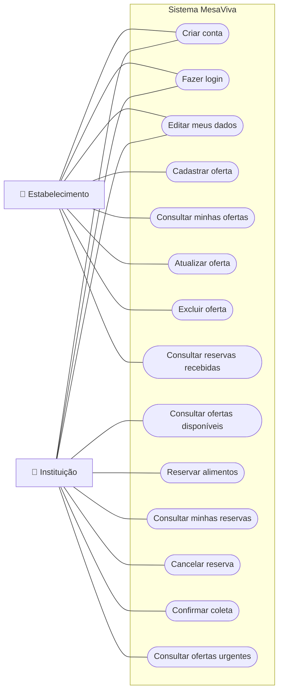
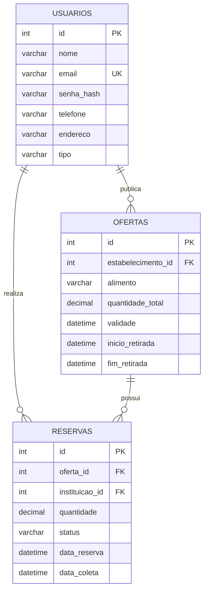
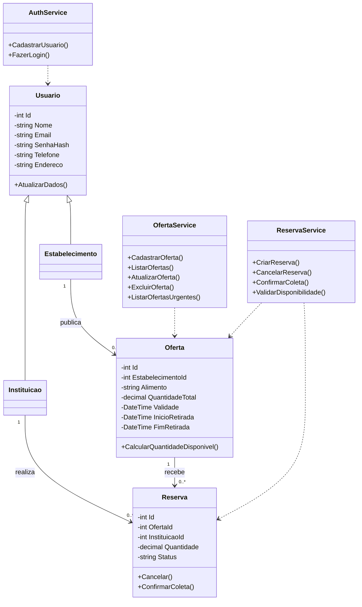
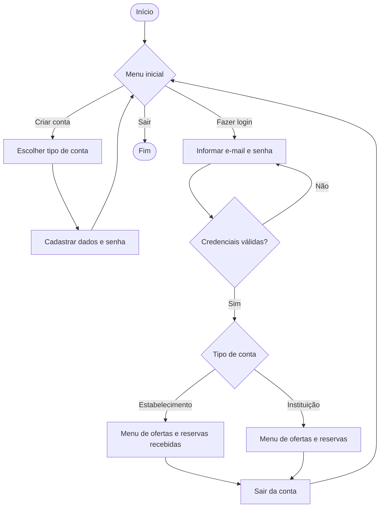

# MesaViva 🍞

**Trabalho integrador — Banco de Dados, Análise de Requisitos e Programação Orientada a Objetos (C#)**

**Integrantes:** Welinton e Leonardo  
**Tema:** Combate ao desperdício de alimentos

## 1. Sobre o projeto

O **MesaViva** é um sistema de console desenvolvido em **C#**, com banco de dados **MySQL**, que conecta estabelecimentos com alimentos excedentes a instituições interessadas em recebê-los.

Os estabelecimentos cadastram ofertas com a quantidade disponível, a validade e os horários de retirada. As instituições consultam essas ofertas, reservam alimentos e confirmam as coletas. O sistema controla as quantidades para evitar reservas acima do disponível.

### Problema

Alimentos que poderiam ser aproveitados acabam desperdiçados, enquanto instituições precisam de doações para atender pessoas em situação de necessidade.

### Objetivo

Organizar a divulgação, a reserva e a retirada de alimentos excedentes de maneira simples, diminuindo desperdícios.

### Público-alvo

- **Estabelecimentos:** padarias, mercados, restaurantes e outros locais que possuem excedentes.
- **Instituições:** ONGs, abrigos e projetos sociais que recebem alimentos.

## 2. Funcionamento do sistema

Na tela inicial, o usuário poderá **fazer login**, **criar uma conta** ou **sair**. Durante o cadastro, ele escolhe entre os perfis **Estabelecimento** e **Instituição**.

Depois do login, aparece o menu correspondente ao tipo de conta. **Não haverá perfil de administrador** nesta versão.

### Menu inicial

```text
========== MESAVIVA ==========
1 - Fazer login
2 - Criar conta
0 - Sair
```

### Menu do estabelecimento

```text
1 - Cadastrar oferta
2 - Consultar minhas ofertas
3 - Atualizar oferta
4 - Excluir oferta
5 - Consultar reservas recebidas
6 - Editar meus dados
0 - Sair da conta
```

### Menu da instituição

```text
1 - Consultar ofertas disponíveis
2 - Reservar alimentos
3 - Consultar minhas reservas
4 - Cancelar reserva
5 - Confirmar coleta
6 - Consultar ofertas urgentes
7 - Editar meus dados
0 - Sair da conta
```

### Exemplo prático

Uma padaria cadastra **12 kg de pães**, com retirada das **16h às 18h**. Uma instituição reserva **8 kg** e outra reserva **4 kg**. Como toda a quantidade foi reservada, o sistema impede novas reservas dessa oferta. Após a retirada, cada instituição confirma sua coleta.

## 3. Requisitos funcionais (RF)

| Código | Descrição |
|---|---|
| RF01 | Permitir cadastro de usuários como estabelecimento ou instituição. |
| RF02 | Permitir login por e-mail e senha. |
| RF03 | Exibir um menu específico para cada tipo de conta. |
| RF04 | Permitir que o usuário consulte e atualize seus dados cadastrais. |
| RF05 | Permitir que estabelecimentos cadastrem ofertas de alimentos. |
| RF06 | Permitir que estabelecimentos consultem suas ofertas. |
| RF07 | Permitir que estabelecimentos atualizem ou excluam suas ofertas, respeitando as regras de negócio. |
| RF08 | Permitir que estabelecimentos consultem as reservas de suas ofertas. |
| RF09 | Permitir que instituições consultem e busquem ofertas disponíveis. |
| RF10 | Permitir que instituições reservem uma quantidade de alimentos. |
| RF11 | Permitir que instituições consultem suas reservas. |
| RF12 | Permitir que instituições cancelem reservas ainda não coletadas. |
| RF13 | Permitir que instituições confirmem a coleta de reservas ativas. |
| RF14 | Exibir ofertas urgentes, próximas ao fim do horário de retirada. |

## 4. Requisitos não funcionais (RNF)

| Código | Descrição |
|---|---|
| RNF01 | O sistema será desenvolvido em C# com .NET. |
| RNF02 | Os dados serão persistidos em um banco MySQL. |
| RNF03 | A interface será de console, com menus interativos. |
| RNF04 | O código aplicará conceitos de POO, como classes, métodos e encapsulamento. |
| RNF05 | O projeto terá separação entre modelos, regras de negócio, acesso ao banco e menus. |
| RNF06 | As entradas serão validadas e erros serão apresentados com mensagens compreensíveis. |
| RNF07 | Senhas serão armazenadas usando hash seguro, nunca em texto puro. |

## 5. Regras de negócio (RN)

| Código | Regra |
|---|---|
| RN01 | Apenas usuários autenticados poderão utilizar os menus internos. |
| RN02 | Cada e-mail só poderá estar associado a uma conta. |
| RN03 | Apenas estabelecimentos poderão publicar e gerenciar ofertas. |
| RN04 | Apenas instituições poderão realizar, cancelar e confirmar suas próprias reservas. |
| RN05 | Cada estabelecimento poderá alterar ou excluir somente suas próprias ofertas. |
| RN06 | A quantidade de uma reserva deve ser maior que zero e não pode ultrapassar a quantidade disponível. |
| RN07 | Não será permitido reservar alimentos vencidos ou após o fim do prazo de retirada. |
| RN08 | Cancelar uma reserva ativa libera novamente a quantidade reservada. |
| RN09 | Uma reserva só poderá ter a coleta confirmada uma vez. Reservas canceladas ou já coletadas não poderão ser confirmadas novamente. |
| RN10 | Ofertas com reservas registradas não poderão ser excluídas, para preservar o histórico. |
| RN11 | Uma oferta será urgente quando faltar até 2 horas para encerrar a retirada e ainda houver quantidade disponível. |
| RN12 | Para simplificar, as quantidades de alimentos serão cadastradas em quilogramas (kg). |

**Cálculo de disponibilidade:** quantidade total da oferta menos a soma das reservas com status `RESERVADA` ou `COLETADA`. Reservas `CANCELADA` não ocupam quantidade. Assim, o banco não precisa guardar um campo de disponibilidade que pode ficar desatualizado.

## 6. Diagramas

Os diagramas abaixo usam **Mermaid**, que pode ser renderizado diretamente no README do GitHub.

### 6.1. Diagrama de casos de uso (representação simplificada)



### 6.2. Diagrama entidade-relacionamento (DER)



**Relacionamentos:** um estabelecimento pode publicar várias ofertas; uma instituição pode realizar várias reservas; e uma oferta pode possuir várias reservas. Os campos `estabelecimento_id` e `instituicao_id` apontam para `USUARIOS`, e o tipo de cada conta será validado pelo sistema.

### 6.3. Diagrama de classes (proposta inicial)



*Os métodos e as classes de serviço poderão ser ajustados quando começarmos a implementação. A herança é usada no C#, enquanto os dois perfis compartilham a tabela `USUARIOS` no banco.*

### 6.4. Fluxo de login e menus



## 7. Estrutura sugerida do código

```text
MesaViva/
├── Models/
│   ├── Usuario.cs
│   ├── Estabelecimento.cs
│   ├── Instituicao.cs
│   ├── Oferta.cs
│   └── Reserva.cs
├── Services/
│   ├── AuthService.cs
│   ├── OfertaService.cs
│   └── ReservaService.cs
├── Data/
│   ├── ConnectionFactory.cs
│   ├── UsuarioRepository.cs
│   ├── OfertaRepository.cs
│   └── ReservaRepository.cs
├── UI/
│   ├── MenuInicial.cs
│   ├── MenuEstabelecimento.cs
│   └── MenuInstituicao.cs
├── Database/
│   └── mesaviva.sql
├── Program.cs
└── README.md
```

## 8. Tecnologias previstas

- **C# / .NET:** implementação do sistema e das regras de negócio.
- **MySQL:** armazenamento dos usuários, ofertas e reservas.
- **MySql.Data:** conexão entre C# e MySQL.
- **Git e GitHub:** versionamento e organização do trabalho.
- **Mermaid/UML:** representação dos diagramas.

## 9. O que será demonstrado na apresentação

1. Criação de uma conta de estabelecimento e outra de instituição.
2. Login e acesso aos menus específicos.
3. Cadastro, consulta, atualização e exclusão de uma oferta sem reservas.
4. Reserva de parte da quantidade disponível de outra oferta.
5. Tentativa de reservar uma quantidade maior que a disponível (validação).
6. Cancelamento ou confirmação de uma coleta.
7. Consulta às ofertas urgentes.
8. Encerramento e reabertura do programa, comprovando que os dados continuam no MySQL.
9. Explicação dos diagramas, relacionamentos e conceitos de POO aplicados.

## 10. Planejamento de 14 dias

| Período | Atividade |
|---|---|
| Dias 1–2 | Fechar requisitos e diagramas. |
| Dias 3–4 | Criar tabelas MySQL, conexão e classes principais. |
| Dias 5–7 | Implementar cadastro, login, menus e CRUD de ofertas. |
| Dias 8–10 | Implementar reservas, coletas e validações. |
| Dia 11 | Implementar consulta de ofertas urgentes. |
| Dia 12 | Testar os fluxos e corrigir erros. |
| Dia 13 | Revisar README, documentação e slides. |
| Dia 14 | Ensaiar a demonstração. |

## 11. Status do projeto

- [x] Definição do tema e escopo
- [x] Planejamento dos requisitos
- [x] Propostas iniciais dos diagramas
- [ ] Revisão e aprovação dos diagramas
- [ ] Criação do banco de dados
- [ ] Implementação em C#
- [ ] Testes
- [ ] Apresentação final

---

**MesaViva — projeto acadêmico desenvolvido por Welinton e Leonardo.**
